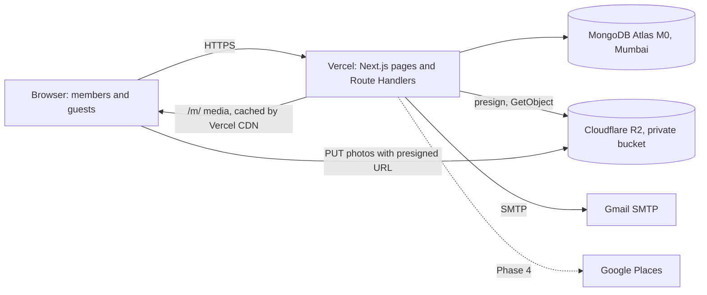

# Make My Marriage: System Design (V1)

**Version:** 1.0 · **Date:** 11 Oct 2026 · **Status:** Draft, ready to build · **Source:** PRD V1

---

## 1. Scope and constraints

| Constraint | Decision |
|---|---|
| Usage | One real wedding, about 100 guests. Cross-wedding isolation is still enforced (PRD §13) |
| Cost | Free tiers only: Vercel Hobby, Atlas M0, Cloudflare R2, Gmail SMTP |
| Domain | None. Every absolute URL is built from `APP_BASE_URL` (`https://<project>.vercel.app`) |
| Infra | No worker, queue, Redis, cache or external monitoring |
| RSVP | **One RSVP per guest, covering all invited events** |
| Photos | Images only. No video |
| Guest links | WhatsApp is the primary channel. Email is optional |

---

## 2. Architecture



**Principles**

- **Modular monolith:** one Next.js app, one deployable.
- **Thin handlers:** Route Handlers validate input with Zod, call a service and return JSON. Business logic lives in `services/`.
- **Tenant scoping in the data layer:** repositories always require `weddingId`.
- **Stateless serverless functions:** a cached DB connection, no in-memory state, and no long-running work.

---

## 3. Stack

| Concern | Choice |
|---|---|
| Language | TypeScript |
| Frontend | Next.js (App Router), mobile-first |
| API | REST via Route Handlers under `/api` |
| Database | MongoDB Atlas M0 (AWS Mumbai) with Mongoose |
| Validation | Zod, one schema per DTO, shared by client and server |
| Auth | Hand-rolled cookie sessions for members, token links for guests |
| Passwords | `@node-rs/argon2` (fallback: `bcryptjs`) |
| Files | Cloudflare R2, private bucket, S3 API (`@aws-sdk/client-s3` and presigner) |
| CDN | Vercel's edge cache through a `/m/` media route |
| Email | Nodemailer over Gmail SMTP behind an `EmailProvider` interface |
| QR | `qrcode` |
| Image resize | In the browser (canvas or `browser-image-compression`) |
| Hosting | Vercel Hobby, region `bom1`. Hobby is non-commercial, which fits a personal wedding |
| Logging | JSON `console` logs to Vercel |

---

## 4. Code structure

```
src/
  app/
    (public)/invite/[token]  g/[galleryToken]  w/[slug]  login  signup
    (app)/dashboard events tasks guests expenses vendors website photos livestream settings
    api/...  (Route Handlers)
    m/[key]/[variant]/route.ts   (media proxy)
  modules/<name>/{schema.ts, repo.ts, service.ts, dto.ts}
    auth weddings members events tasks guests invitations
    expenses vendors website gallery livestream dashboard
  lib/ db.ts session.ts guard.ts r2.ts email/ ratelimit.ts logger.ts urls.ts dates.ts money.ts
```

- Modules call other modules' **services**, never their repositories (enforce with an ESLint boundaries rule).
- `urls.ts` is the only place that builds absolute URLs (`APP_BASE_URL`) and media URLs (`mediaUrl(photo, variant)`). Adding a domain or an R2 custom domain later is a one-file change.

---

## 5. Data model (MongoDB)

IDs are ObjectIds unless noted. Every tenant collection has `weddingId`.

**`users`**: `name`, `email` (unique, lowercased), `passwordHash`, `createdAt`.

**`sessions`**: `tokenHash` (unique), `userId`, `expiresAt` (TTL index), `createdAt`.

**`passwordResets`**: `tokenHash`, `userId`, `expiresAt` (TTL, 1 hour).

**`weddings`**
- Identity: `title`, `brideName`, `groomName`, `description`, `coverKey`
- Date and place: `date` (`YYYY-MM-DD`), `timezone` (default `Asia/Kolkata`), `city`, `venueName?`, `address?`, `lat?`, `lng?`
- Links: `slug` (unique), `galleryToken` (unique, 128-bit random)
- Embedded settings:
  - `gallery: {enabled, guestUploadEnabled}`
  - `website: {theme, published, welcomeMessage, showGallery}`
  - `livestream: {youtubeVideoId?}`

**`memberships`**: `weddingId`, `userId` (**unique**, enforces Rule 1), `role` (`admin | manager`), `createdAt`.

**`memberInvites`**: `weddingId`, `token` (unique), `role`, `label?`, `expiresAt` (TTL, 7 days), `acceptedAt?`, `createdBy`.

**`events`**: `weddingId`, `name`, `type`, `date`, `startTime`, `endTime` (`HH:mm`), `venueName?`, `address?`, `lat?`, `lng?`, `description`, `dressCode`, `coverKey?`.

**`tasks`**: `weddingId`, `title`, `description`, `assigneeId?`, `eventId?`, `dueDate?`, `priority` (`low | medium | high`), `status` (`todo | in_progress | completed`).

**`guests`** (one document equals one invitation)
- `weddingId`, `name`, `email?`, `phone?`, `notes`
- `maxGuests` (≥ 1)
- `invitedEventIds[]`
- `inviteToken` (unique, 128-bit random)
- `invite: {sentAt?, lastSentAt?, sendCount, firstViewedAt?, lastViewedAt?}`
- `rsvp: {status: pending | attending | not_attending, attendingCount, respondedAt?}`

**`vendors`**: `weddingId`, `name`, `category`, `contactPerson`, `phone`, `email`, `address`, `website`, `agreedCostPaise?`, `eventIds[]`, `notes`, `source: {type: manual | discovery, placeId?}`.

**`expenses`**: `weddingId`, `title`, `amountPaise` (integer), `date`, `category`, `eventId?`, `vendorId?`, `notes`.

**`photos`**
- `weddingId`, `eventId?` (null means "Other / Wedding Memories")
- `photoKey` (128-bit random hex, used in storage keys and URLs)
- `status` (`pending | ready`)
- `uploadedBy: {kind: member | guest, userId?}`
- `hasOriginal`, `sizeBytes`, `createdAt`

**`rateLimits`**: `key`, `count`, `expiresAt` (TTL).

**Indexes**
- `memberships {userId}` unique, `{weddingId}`
- `guests {inviteToken}` unique, `{weddingId, rsvp.status}`
- `events {weddingId, date}`
- `tasks {weddingId, status, dueDate}`, `{weddingId, assigneeId}`
- `expenses {weddingId, date}`
- `photos {weddingId, status, eventId, createdAt:-1}`, `{photoKey}` unique
- `weddings {slug}`, `{galleryToken}` unique

**Conventions**
- **Dates:** store date and time as local strings plus the wedding timezone. Never store the "wedding day" as a UTC `Date`. Compute "days to go" in the wedding timezone.
- **Money:** integer paise, formatted with `Intl.NumberFormat('en-IN')` (₹12,45,000).
- **Location:** plain numeric `lat`/`lng` validated with Zod (lat −90 to 90, lng −180 to 180). Admins paste `lat, lng` copied from Google Maps. Map link: `https://www.google.com/maps/search/?api=1&query={lat},{lng}`.
- **Event delete:** hard delete after a preview call that returns the affected guest count. It removes the event from `guests.invitedEventIds` and `vendors.eventIds`, nulls `tasks.eventId` and `expenses.eventId`, and moves its photos to "Other".

---

## 6. Authentication and authorization

**Members**
- **Signup:** name, email, password. No email verification. A new user with no membership is routed to **Create wedding** or **Join with invite link**.
- **Session:** the cookie holds a random 32-byte token and the DB stores its SHA-256. Cookie flags: httpOnly, Secure, SameSite=Lax, 30-day sliding expiry.
- **Per-request guard:** `requireMember(minRole)` loads the session, then the membership, and returns `{userId, weddingId, role}`. Role is **never** read from the cookie, so removals and role changes apply immediately.
- **Logout:** delete the session. **Reset:** hashed token, 1 hour, sent by email.
- **CSRF:** SameSite=Lax plus an `Origin` check on mutating handlers.
- **Cross-wedding isolation:** `weddingId` always comes from the session. Repository methods require it as their first argument, with no unscoped `findById`. Foreign IDs return **404**, not 403.

**Permission matrix**

| Capability | Admin | Manager | Guest |
|---|---|---|---|
| Wedding data (events, tasks, guests, expenses, vendors, website, gallery, livestream) | ✔ | ✔ | none |
| Manage members, roles, invites | ✔ | none | none |
| Own invitation, RSVP | none | none | via token |
| View and upload gallery photos | ✔ | ✔ | via gallery token |

**Member invites**
- The invite token is the credential. Do **not** match it against the signup email, because emails are unverified.
- Tokens are one-time with a 7-day TTL and carry the role. The primary delivery is "Copy link" or "Share on WhatsApp".
- Accepting requires login. If the user has no account, the link goes to signup first and then redirects to accept.
- A user who already belongs to a wedding cannot accept (Rule 1).
- **Last-admin rule:** demote and remove run inside a Mongo transaction that checks at least one other admin remains.

**Guests**
- Access is by `inviteToken` (invitation) or `galleryToken` (gallery). Neither grants any dashboard access.

---

## 7. API (REST, `/api`)

| Area | Endpoints |
|---|---|
| Auth | `POST auth/signup · login · logout · forgot · reset` |
| Wedding | `POST weddings` (only if no membership), `GET/PATCH wedding`, `GET dashboard` |
| Members | `GET members`, `POST members/invites`, `DELETE members/invites/:id`, `PATCH members/:userId` (role), `DELETE members/:userId`, `POST invites/accept` |
| Events | `GET/POST events`, `PATCH/DELETE events/:id` (`?preview=1` for impact) |
| Tasks | `GET/POST tasks` (filters: status, event, assignee, priority, `mine`), `PATCH/DELETE tasks/:id` |
| Guests | `GET/POST guests`, `PATCH/DELETE guests/:id`, `POST guests/import` (CSV parsed client-side), `GET guests/:id/share` |
| Invitations | `POST invitations/send` (≤ 20 guest IDs), `POST invitations/remind` (≤ 20 pending guest IDs) |
| Expenses | `GET/POST expenses`, `PATCH/DELETE expenses/:id`, `GET expenses/summary` |
| Vendors | CRUD `vendors`, `GET vendors/discover?q&category` (Phase 4) |
| Website | `GET/PATCH website` |
| Livestream | `PUT/DELETE livestream` |
| Gallery (member) | `GET gallery/photos?cursor&eventId`, `POST gallery/uploads`, `POST gallery/uploads/complete`, `DELETE photos/:id`, `GET photos/:id/download`, `PATCH gallery/settings`, `POST gallery/token/rotate` |
| Public, invitation | `GET public/invite/:token`, `PUT public/invite/:token/rsvp` |
| Public, gallery | `GET public/g/:token/photos?cursor&eventId`, `POST public/g/:token/uploads`, `POST public/g/:token/uploads/complete` |
| Media | `GET /m/:photoKey/:variant` (`display` or `thumb`) |

Errors use one JSON shape: `{error: {code, message, fields?}}`. List endpoints use cursor pagination on `(createdAt, _id)`.

---

## 8. Key flows

### 8.1 Invitation and RSVP

1. A member adds guests (manually or by CSV import), picks `invitedEventIds` and sets `maxGuests`. The system generates `inviteToken` (`crypto.randomBytes(16)`, base64url, about 22 chars). The PRD's 6-character example is too easy to enumerate.
2. `/invite/[token]` renders couple names, welcome message and **only the events in `invitedEventIds`** (date, time, venue, map link), plus one RSVP form.
3. RSVP is `PUT /public/invite/:token/rsvp` with `{status, attendingCount}`.
   - `attending` requires `1 ≤ attendingCount ≤ maxGuests`.
   - `not_attending` forces `attendingCount = 0`.
   - The call is idempotent and can be repeated to edit.
4. **One RSVP applies to all events.** Per-event attendance is out of scope for V1.
5. Invalid or unknown tokens return the same generic 404 page. Resolution is rate-limited per IP.
6. `firstViewedAt` and `lastViewedAt` are set only for non-bot user agents, so WhatsApp's link-preview crawler doesn't inflate open rate. The page serves generic OG tags (couple names and date, no guest name).
7. If an admin lowers `maxGuests` below an existing `attendingCount`, the guest list flags it. The system never silently edits an RSVP.

### 8.2 Sending invitations

- **WhatsApp (primary):** `https://wa.me/{phone}?text={encoded message + link}`, or `https://wa.me/?text=…` when there is no phone.
- **Email:** an `EmailProvider` interface with `send(message)`. The default implementation is Nodemailer over Gmail SMTP (app password, 2-Step Verification required).
  - `POST invitations/send` and `/remind` take **at most 20 guests** per request and send with concurrency 5.
  - The handler returns per-guest results and updates `invite.sentAt/lastSentAt/sendCount` on success. The UI loops the chunks with a progress bar. "Send reminder" selects `rsvp.status = pending` guests that have an email.
  - Gmail limits personal accounts to roughly 500 recipients per day (verify current limits), which is plenty for 100 guests. The sender shows as your Gmail address.
  - Resend needs a verified domain to email anyone but yourself. If you later buy a domain, add a `ResendProvider` and change one env var.
- **Email types:** invitation, reminder, password reset. Member-invite emails are optional, since copy-link is the default.

### 8.3 Photo upload and serving

**Why this shape:** Vercel limits request bodies to about 4.5 MB, so uploads go straight to R2. R2 does not support presigned POST policies, so uploads use presigned PUT.

1. **Resize in the browser:** the client creates `display` (max 2000 px JPEG, quality about 0.8) and `thumb` (max 400 px JPEG). Re-encoding through canvas also normalizes iPhone HEIC. Member uploads additionally keep `original`.
2. **Init:** `POST …/uploads` with `{files: [{size, hasOriginal?}], eventId?}`.
   - It checks `gallery.enabled` and, for guests, `guestUploadEnabled` (default **off**).
   - Limits: display ≤ 5 MB, thumb ≤ 500 KB, original ≤ 25 MB (members only), 3,000 photos per wedding, and a rate limit per gallery token.
   - It creates `pending` photos with a random `photoKey` and returns presigned PUT URLs for `p/{photoKey}/display.jpg`, `thumb.jpg` and optionally `original`. Each signs `Content-Type` and `Content-Length`, with a 5-minute expiry.
3. **Upload:** the client PUTs 3 photos at a time with per-file retry. The bucket CORS allows `PUT` from `APP_BASE_URL`.
4. **Complete:** the server does `HEAD` on each object to verify size, and a 12-byte ranged `GET` to verify JPEG magic bytes. It then sets `ready`. On failure it deletes the objects and the document.
5. **Cleanup:** `pending` photos older than 1 hour are removed lazily on member gallery reads, so no cron is needed.
6. **Serve:** `/m/{photoKey}/{variant}` streams the object from the private bucket with `Cache-Control: public, max-age=86400, s-maxage=86400`, so Vercel's CDN caches it. A 24-hour TTL (not immutable) bounds how long a deleted photo stays cached. Keys are unguessable, so the cached response needs no auth. Use plain `` and lazy loading, not `next/image` optimization.
7. **Originals and downloads:** never proxied. `GET photos/:id/download` redirects to a 5-minute presigned R2 GET. Multi-select download is sequential in V1, and zip is deferred.
8. **Albums:** `eventId` (nullable) groups photos. The gallery filters by event, with "Other / Wedding Memories" for null.
9. **Delete (member only):** removes the document and its R2 objects.
10. **After the wedding:** the gallery keeps working until `gallery.enabled` is turned off.

### 8.4 QR code

- The QR encodes `${APP_BASE_URL}/g/${galleryToken}` and is generated on demand with `qrcode` (SVG for print, PNG at 1024 px for download). Nothing is stored.
- The page shows "Share the Memories 📸" copy for printing.
- The URL is stable. **Regenerate link** is an explicit action with a warning that printed QRs stop working.

### 8.5 Website and livestream

- `/w/[slug]` is server-rendered with `revalidate = 60`. The slug is auto-generated from the couple names, unique, with a reserved-words list.
- Three themes (Classic Indian, Minimal Elegant, Modern Celebration) are React components that consume one `WebsiteViewModel`. Changing a theme changes presentation only.
- Sections: Hero, Welcome, Events (with map link), Gallery, Livestream.
- **Gallery section:** when `website.showGallery` is on, it shows a "View photos" button to `/g/{galleryToken}`. This means anyone who sees the website can open the gallery. Default is off.
- **Livestream:** parse a YouTube URL (`watch?v=`, `youtu.be/`, `/live/`, `/embed/`), store only the video ID, and embed `https://www.youtube-nocookie.com/embed/{id}`.

### 8.6 Vendors and discovery

- **My Vendors** and **Expenses** are plain CRUD. A vendor without an expense and an expense without a vendor are both valid.
- **Discover (Phase 4):** a server-side proxy to Google Places API (New) Text Search with a restricted key and a field mask. It needs a Google Cloud billing account (free monthly credit).
- Results are rate-limited per wedding. "Add to My Vendors" saves `source.placeId` plus the fields the user confirms. Check Google's terms before persisting more than the place ID.

### 8.7 Dashboard

- `GET dashboard` runs `countDocuments` and small aggregations (events, tasks done/total, guests, RSVP responded, total attending, expense sum, vendors).
- Also returns the next events, the next incomplete tasks by due date, and days to go. At about 100 guests no caching is needed.

---

## 9. Security

- **Headers:** `Referrer-Policy: no-referrer` and `X-Robots-Tag: noindex, nofollow` on `/invite/*`, `/g/*` and `/w/*` (indexing off in V1). `robots.txt` disallows `/app`, `/api`, `/invite`, `/g`.
- **CSP:** `default-src 'self'`; `img-src 'self' data: blob:`; `frame-src https://www.youtube-nocookie.com`; `connect-src 'self' https://<account>.r2.cloudflarestorage.com`. `script-src` allows `'self'` plus what Next requires.
- **Rate limits** (Mongo TTL counters):

| Action | Key | Limit |
|---|---|---|
| Login | IP + email | 10 / 15 min |
| Signup | IP | 10 / hour |
| Forgot password | IP + email | 5 / hour |
| Invite resolve and RSVP | IP | 60 / 10 min |
| Upload init | gallery token | 60 / 10 min |
| Vendor discovery | weddingId | 30 / hour |

- **Validation:** Zod on every input. Server-side limits on sizes, counts, MIME and magic bytes.
- **Secrets:** server-only env vars, never `NEXT_PUBLIC_`.
- **Atlas:** network access must be `0.0.0.0/0` (Vercel has no static IPs on the free tier), so use a strong, dedicated DB user and password.
- **Isolation tests:** for every member route, a user of wedding B must get 404 on wedding A's IDs.

---

## 10. PRD edge cases

| Case (PRD §14) | Handling |
|---|---|
| Invited email already has an account | Accept works for any logged-in user without a wedding |
| Invitation expires | TTL plus an "invite expired" page |
| Remove a Manager, multiple Admins | Allowed. Last-admin check in a transaction |
| Final Admin removed or demoted | Rejected with an error |
| Invalid or expired guest link | Generic 404 page |
| RSVP twice, or changed | Idempotent `PUT`, latest wins |
| RSVP above `maxGuests` | 422 from the server, and the UI only offers valid counts |
| Guest has no email | WhatsApp link only, and the email buttons skip them |
| Event after wedding date, or without venue | Allowed, with a UI hint |
| Event deleted after invites | Preview of affected guests, then cascade (see §5) |
| Unsupported or oversized upload | Rejected at init, and by the complete-step checks |
| Upload fails midway | Per-file retry, and `pending` records are swept lazily |
| QR scanned after the wedding | Works until the gallery is disabled |

---

## 11. Deployment and operations

- **Repo and deploys:** GitHub repo to Vercel, auto-deploy on push. `vercel.json` sets `"regions": ["bom1"]`.
- **Project name:** pick it carefully, because it appears in every guest link (`https://<project>.vercel.app`).
- **Database:** Atlas M0 in AWS Mumbai. M0 has no automated backups, so run `mongodump` weekly and once before the wedding.
- **R2:** a private bucket with CORS allowing `PUT`/`GET`/`HEAD` from `APP_BASE_URL`. R2 may ask for a card on file even though usage stays in the free tier.
- **Env vars:** `MONGODB_URI`, `APP_BASE_URL`, `R2_ACCOUNT_ID`, `R2_ACCESS_KEY_ID`, `R2_SECRET_ACCESS_KEY`, `R2_BUCKET`, `GMAIL_USER`, `GMAIL_APP_PASSWORD`, `GOOGLE_PLACES_API_KEY` (Phase 4, optional).
- **Logging:** `logger.ts` writes JSON lines with `requestId`, `route`, `userId`, `weddingId`, `status`, `ms`. Log retention on Hobby is short, so don't treat it as history.
- **Adding a domain later:** set `APP_BASE_URL`, add the domain in Vercel, and optionally bind an R2 custom domain by changing `mediaUrl()`. No other changes.
- **Metrics (PRD §15):** derive them from the database (counts, `invite.firstViewedAt`, `rsvp.respondedAt`, photo counts). No analytics tool.

---

## 12. Testing

- **Vitest** for services and Zod schemas. Highest priority: RSVP rules, last-admin rule, tenant isolation, upload init limits.
- **Route tests** against a test Mongo database for auth, guards and the public endpoints.
- **Manual mobile pass** for invitation, RSVP, upload and gallery on a real iPhone and Android device.

---

## 13. Build phases

| Phase | Deliverables |
|---|---|
| 1 Foundation | Project setup, DB, auth, sessions, wedding creation, members and invites, dashboard shell |
| 2 Planning | Events, tasks |
| 3 Guests | Guests, CSV import, invitation page, RSVP, WhatsApp share, Gmail email and reminders |
| 4 Money and vendors | Expenses, My Vendors, discovery (optional) |
| 5 Experience | Website, 3 themes, livestream |
| 6 Memories | R2 pipeline, gallery, albums, guest upload, QR |
| 7 Hardening | Security headers and CSP, rate limits, isolation tests, mobile pass, backups |

---

## 14. Risks and assumptions

| # | Item | Mitigation |
|---|---|---|
| 1 | Gmail SMTP instead of Resend (no domain). Deliverability and the daily limit are less predictable | WhatsApp is primary. `EmailProvider` makes a swap trivial |
| 2 | Media goes through Vercel functions and bandwidth limits | Small variants only (thumb and display). Originals use presigned R2 URLs |
| 3 | A public website exposing the gallery link | `showGallery` is off by default |
| 4 | Atlas M0 has no backups | Manual `mongodump` schedule |
| 5 | Unverified signup emails | Invite tokens are the credential, and a user with no invite sees no wedding data |
| 6 | Google Places terms and billing | Phase 4 and optional. Store only `placeId` plus user-confirmed fields |
| 7 | Free-tier limits can change | Re-check Vercel, Atlas, R2 and Gmail limits before launch |
