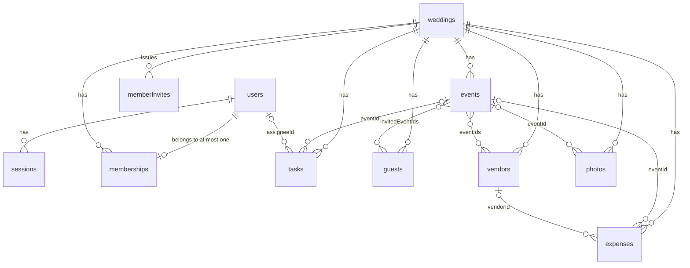

# Make My Marriage: Database Design (V1)

**Version:** 1.0 · **Date:** 11 Oct 2026 · **Status:** Draft, ready to build · **Depends on:** PRD V1, System Design V1.0

**Engine:** MongoDB Atlas M0 (AWS Mumbai, replica set, so transactions work) · **ODM:** Mongoose · **Validation:** Zod at the API edge, Mongoose as a backstop

---

## 1. Conventions

| Topic | Rule |
|---|---|
| IDs | ObjectId `_id`. Security-sensitive identifiers (`inviteToken`, `galleryToken`, `photoKey`, session and invite tokens) are separate 128-bit random values, never ObjectIds |
| Tenant key | Every wedding-owned collection has `weddingId` (ObjectId, required). All queries include it |
| Timestamps | Mongoose `timestamps: true` (`createdAt`, `updatedAt`, UTC `Date`) on every collection except `rateLimits` |
| Calendar dates | `YYYY-MM-DD` strings (valid calendar date). Times are `HH:mm` strings. Timezone lives on the wedding (default `Asia/Kolkata`) |
| Money | Positive integer **paise** (`amountPaise`). Display with `Intl.NumberFormat('en-IN')` |
| Strings | `trim`. Emails are lowercased. Max lengths are set per field (see §3) |
| Optional fields | Omit the field rather than storing `null`, except `eventId` fields, where `null` means "no event" |
| Deletes | Hard delete everywhere. Cascades are explicit (§5). No soft delete, no activity log (PRD non-goal) |
| Arrays | Only small, bounded arrays are embedded (`invitedEventIds`, `eventIds`): tens of items at most |
| Names | Collections are plural camelCase (`memberInvites`). Fields are camelCase. Enums are snake_case strings |

---

## 2. Entity relationships



**Embed vs reference**

| Data | Decision | Why |
|---|---|---|
| Gallery, website and livestream settings | Embedded in `weddings` | 1:1, always read with the wedding, never queried alone |
| RSVP and invite tracking | Embedded in `guests` | One RSVP per guest, always read and written with the guest |
| Guest to events | `invitedEventIds[]` on the guest | Small bounded list, one read renders the invitation |
| Vendor to events | `eventIds[]` on the vendor | Same reason |
| Everything else | Separate collections, referenced by ID | Different lifecycles and independent queries |

---

## 3. Collections

Legend: **R** = required. Types are Mongoose types.

### 3.1 `users`

| Field | Type | R | Rules |
|---|---|---|---|
| name | String | ✔ | 1 to 100 |
| email | String | ✔ | lowercase, ≤ 254, valid format |
| passwordHash | String | ✔ | argon2id output, never returned by any API |

Indexes: `{email: 1}` **unique**.

### 3.2 `sessions`

| Field | Type | R | Rules |
|---|---|---|---|
| tokenHash | String | ✔ | SHA-256 hex of the cookie token |
| userId | ObjectId | ✔ | |
| expiresAt | Date | ✔ | now + 30 days |

Indexes: `{tokenHash: 1}` unique · `{expiresAt: 1}` TTL (`expireAfterSeconds: 0`) · `{userId: 1}`.

- Sliding expiry: extend `expiresAt` at most once a day, not on every request.
- The TTL monitor runs about once a minute, so reads must also check `expiresAt > now`.

### 3.3 `passwordResets`

| Field | Type | R | Rules |
|---|---|---|---|
| tokenHash | String | ✔ | SHA-256 hex |
| userId | ObjectId | ✔ | |
| expiresAt | Date | ✔ | now + 1 hour |

Indexes: `{tokenHash: 1}` unique · `{expiresAt: 1}` TTL. Delete the document on use.

### 3.4 `weddings`

| Field | Type | R | Rules |
|---|---|---|---|
| title | String | | ≤ 120. Default to "Bride ❤️ Groom" in the UI |
| brideName | String | ✔ | 1 to 80 |
| groomName | String | ✔ | 1 to 80 |
| date | String | ✔ | `YYYY-MM-DD`, the primary wedding date |
| timezone | String | ✔ | IANA name, default `Asia/Kolkata` |
| city | String | ✔ | ≤ 120 (PRD: city/location) |
| venueName | String | | ≤ 160 |
| address | String | | ≤ 400 |
| lat, lng | Number | | Both or neither. lat −90..90, lng −180..180 |
| description | String | | ≤ 2000 |
| coverKey | String | | R2 object key |
| slug | String | ✔ | `[a-z0-9-]{3,60}`, not in the reserved list |
| galleryToken | String | ✔ | 22-char base64url (16 random bytes) |
| gallery.enabled | Boolean | ✔ | default `true` |
| gallery.guestUploadEnabled | Boolean | ✔ | default `false` |
| website.theme | String | ✔ | `classic_indian | minimal_elegant | modern_celebration` |
| website.published | Boolean | ✔ | default `false` |
| website.welcomeMessage | String | | ≤ 1000 |
| website.showGallery | Boolean | ✔ | default `false` |
| livestream.youtubeVideoId | String | | `[A-Za-z0-9_-]{11}` |

Indexes: `{slug: 1}` unique · `{galleryToken: 1}` unique.

### 3.5 `memberships`

| Field | Type | R | Rules |
|---|---|---|---|
| weddingId | ObjectId | ✔ | |
| userId | ObjectId | ✔ | |
| role | String | ✔ | `admin | manager` |

Indexes: `{userId: 1}` **unique** (PRD Rule 1: one user, one wedding) · `{weddingId: 1, role: 1}`.

### 3.6 `memberInvites`

| Field | Type | R | Rules |
|---|---|---|---|
| weddingId | ObjectId | ✔ | |
| token | String | ✔ | 22-char base64url |
| role | String | ✔ | `admin | manager` |
| label | String | | ≤ 100, who the invite is for (display only) |
| createdBy | ObjectId | ✔ | member who issued it |
| expiresAt | Date | ✔ | now + 7 days |
| acceptedAt | Date | | set on use, so an invite works once |

Indexes: `{token: 1}` unique · `{expiresAt: 1}` TTL · `{weddingId: 1}`.

### 3.7 `events`

| Field | Type | R | Rules |
|---|---|---|---|
| weddingId | ObjectId | ✔ | |
| name | String | ✔ | 1 to 100 |
| type | String | ✔ | `roka | engagement | mehendi | haldi | sangeet | cocktail | wedding | reception | custom` |
| date | String | ✔ | `YYYY-MM-DD` |
| startTime, endTime | String | | `HH:mm` |
| venueName, address | String | | ≤ 160 and ≤ 400 |
| lat, lng | Number | | Both or neither |
| description | String | | ≤ 2000 |
| dressCode | String | | ≤ 200 |
| coverKey | String | | R2 object key |

Indexes: `{weddingId: 1, date: 1, startTime: 1}`.

### 3.8 `tasks`

| Field | Type | R | Rules |
|---|---|---|---|
| weddingId | ObjectId | ✔ | |
| title | String | ✔ | 1 to 200 |
| description | String | | ≤ 2000 |
| assigneeId | ObjectId | | must be a member of the same wedding |
| eventId | ObjectId | | must belong to the same wedding |
| dueDate | String | | `YYYY-MM-DD` |
| priority | String | ✔ | `low | medium | high`, default `medium` |
| status | String | ✔ | `todo | in_progress | completed`, default `todo` |

Indexes: `{weddingId: 1, status: 1, dueDate: 1}` · `{weddingId: 1, assigneeId: 1, status: 1}` · `{weddingId: 1, eventId: 1}`.

### 3.9 `guests`

One document is one **invitation**, not one person (PRD §9.7).

| Field | Type | R | Rules |
|---|---|---|---|
| weddingId | ObjectId | ✔ | |
| name | String | ✔ | 1 to 120 |
| email | String | | lowercase, valid format |
| phone | String | | digits only with country code, 10 to 15 digits (used for `wa.me`) |
| maxGuests | Number | ✔ | integer 1..20 |
| invitedEventIds | [ObjectId] | ✔ | may be empty. Each must belong to the same wedding |
| inviteToken | String | ✔ | 22-char base64url (16 random bytes) |
| invite.sentAt, invite.lastSentAt | Date | | |
| invite.sendCount | Number | ✔ | default 0 |
| invite.firstViewedAt, invite.lastViewedAt | Date | | set only for non-bot user agents |
| rsvp.status | String | ✔ | `pending | attending | not_attending`, default `pending` |
| rsvp.attendingCount | Number | ✔ | default 0 |
| rsvp.respondedAt | Date | | |
| notes | String | | ≤ 1000 |

Indexes: `{inviteToken: 1}` unique · `{weddingId: 1, rsvp.status: 1}` · `{weddingId: 1, name: 1}`.

**Invariants**
- The schema hook enforces consistency only: `attending` requires `attendingCount ≥ 1`, and any other status requires `0`.
- The `attendingCount ≤ maxGuests` check happens in the RSVP write itself (§6), not in the schema. Otherwise an admin lowering `maxGuests` would be blocked. The guest list shows a flag when `attendingCount > maxGuests`.

```ts
const GuestSchema = new Schema({
  weddingId: { type: Schema.Types.ObjectId, required: true },
  name: { type: String, required: true, trim: true, maxlength: 120 },
  email: { type: String, trim: true, lowercase: true, maxlength: 254 },
  phone: { type: String, match: /^\d{10,15}$/ },
  maxGuests: { type: Number, required: true, min: 1, max: 20, validate: Number.isInteger },
  invitedEventIds: [{ type: Schema.Types.ObjectId }],
  inviteToken: { type: String, required: true, unique: true },
  invite: {
    sentAt: Date, lastSentAt: Date,
    sendCount: { type: Number, default: 0 },
    firstViewedAt: Date, lastViewedAt: Date,
  },
  rsvp: {
    status: { type: String, enum: ['pending', 'attending', 'not_attending'], default: 'pending' },
    attendingCount: { type: Number, default: 0, min: 0 },
    respondedAt: Date,
  },
  notes: { type: String, maxlength: 1000 },
}, { timestamps: true, autoIndex: false });

GuestSchema.index({ weddingId: 1, 'rsvp.status': 1 });
GuestSchema.index({ weddingId: 1, name: 1 });
GuestSchema.pre('validate', function () {
  const { status, attendingCount } = this.rsvp;
  if (status === 'attending' ? attendingCount < 1 : attendingCount !== 0)
    throw new Error('rsvp.status and attendingCount are inconsistent');
});
```

### 3.10 `vendors`

| Field | Type | R | Rules |
|---|---|---|---|
| weddingId | ObjectId | ✔ | |
| name | String | ✔ | 1 to 160 |
| category | String | ✔ | `photographer | videographer | venue | caterer | decorator | dj | makeup_artist | mehendi_artist | pandit | choreographer | florist | wedding_planner | transport | other` |
| contactPerson, phone, email, address, website | String | | sensible max lengths, website must be http(s) |
| agreedCostPaise | Number | | positive integer |
| eventIds | [ObjectId] | | each must belong to the same wedding |
| notes | String | | ≤ 2000 |
| source.type | String | ✔ | `manual | discovery` |
| source.placeId | String | | only when `discovery` |

Indexes: `{weddingId: 1, category: 1}`.

### 3.11 `expenses`

| Field | Type | R | Rules |
|---|---|---|---|
| weddingId | ObjectId | ✔ | |
| title | String | ✔ | 1 to 200 |
| amountPaise | Number | ✔ | integer, 1 to 1e12 |
| date | String | ✔ | `YYYY-MM-DD` |
| category | String | ✔ | `venue | catering | photography | videography | decoration | clothing | jewellery | entertainment | invitations | gifts | travel | makeup | miscellaneous` |
| eventId | ObjectId | | optional, same wedding |
| vendorId | ObjectId | | optional, same wedding |
| notes | String | | ≤ 1000 |

Indexes: `{weddingId: 1, date: -1}` · `{weddingId: 1, category: 1}`.

### 3.12 `photos`

| Field | Type | R | Rules |
|---|---|---|---|
| weddingId | ObjectId | ✔ | |
| eventId | ObjectId | | `null` means "Other / Wedding Memories" |
| photoKey | String | ✔ | 32-char hex (16 random bytes). R2 keys are `p/{photoKey}/{display|thumb|original}.jpg` |
| status | String | ✔ | `pending | ready`, default `pending` |
| uploadedBy.kind | String | ✔ | `member | guest` |
| uploadedBy.userId | ObjectId | | only for `member` |
| hasOriginal | Boolean | ✔ | default `false` |
| sizeBytes | Number | ✔ | display size, used for quota accounting |

Indexes: `{photoKey: 1}` unique · `{weddingId: 1, status: 1, _id: -1}` · `{weddingId: 1, status: 1, eventId: 1, _id: -1}`.

Gallery pagination uses **`_id` as the cursor**. ObjectIds are time-ordered, so no second sort field is needed.

### 3.13 `rateLimits`

| Field | Type | R | Rules |
|---|---|---|---|
| key | String | ✔ | e.g. `login:{ip}:{email}`, `invite:{ip}`, `upload:{galleryToken}` |
| count | Number | ✔ | |
| expiresAt | Date | ✔ | window end |

Indexes: `{key: 1}` unique · `{expiresAt: 1}` TTL. No `timestamps`.

```ts
// fixed window; retry once on E11000 (two requests racing the first upsert)
const r = await RateLimit.findOneAndUpdate(
  { key },
  { $inc: { count: 1 }, $setOnInsert: { expiresAt: new Date(Date.now() + windowMs) } },
  { upsert: true, new: true },
);
if (r.count > limit) throw new TooManyRequests();
```

---

## 4. Cross-document rules (enforced in services)

MongoDB has no foreign keys, so services check these before every write, always with `weddingId` in the filter:

| Rule | Check |
|---|---|
| `guests.invitedEventIds ⊆ events` of the same wedding | `events.countDocuments({weddingId, _id: {$in: ids}}) === ids.length` |
| `vendors.eventIds ⊆ events` of the same wedding | same |
| `tasks.eventId`, `expenses.eventId`, `photos.eventId` belong to the same wedding | `events.exists({weddingId, _id})` |
| `expenses.vendorId` belongs to the same wedding | `vendors.exists({weddingId, _id})` |
| `tasks.assigneeId` is a member of the same wedding | `memberships.exists({weddingId, userId})` |
| A wedding always has at least one admin | transaction, see §6 |
| A user belongs to at most one wedding | unique index on `memberships.userId` |
| Photo count per wedding ≤ 3,000 | count of `photos` at upload init |

---

## 5. Delete and cascade rules

| Action | Effects | Transaction |
|---|---|---|
| Remove member | Delete the membership. Set `tasks.assigneeId` to unset for that user in this wedding. The user account and sessions remain, so they land on the "Create / Join" screen | ✔ |
| Delete event | `$pull` the event from `guests.invitedEventIds` and `vendors.eventIds`. Unset `tasks.eventId` and `expenses.eventId`. Set `photos.eventId = null`. Then delete the event. A `?preview=1` call returns affected counts first | ✔ |
| Delete guest | Delete the document. The token stops working immediately | |
| Delete vendor | Unset `expenses.vendorId`, then delete the vendor | ✔ |
| Delete photo (member) | Delete the document first, then the 2 to 3 R2 objects (best effort) | |
| Rotate `galleryToken` | Replace the value. Old QR codes and links stop working | |
| Delete wedding / user | **Not in V1** (no UI). Handle manually with a script if ever needed | |

R2 deletes happen outside any transaction, so a failure can leave orphaned objects. That is acceptable. A manual script can list objects with no matching `photoKey`.

---

## 6. Transactions and atomic operations

Atlas M0 is a replica set, so multi-document transactions are available. Keep them short.

| Operation | How |
|---|---|
| Create wedding | Transaction: insert `weddings`, insert `memberships` (role `admin`). If the unique `userId` index fails, the user is already in a wedding, so abort |
| Accept member invite | Transaction: `memberInvites.findOneAndUpdate({token, acceptedAt: {$exists: false}, expiresAt: {$gt: now}}, {$set: {acceptedAt: now}})`, then insert the membership. The unique `userId` index blocks a second wedding |
| Demote or remove an admin | Transaction: count `memberships` with `role: 'admin'` for the wedding. Reject if the target is the only admin. Then write |
| Event, vendor and member cascades | Transactions, per §5 |
| RSVP (single atomic update) | See below. No transaction needed |
| Invitation send bookkeeping | `$inc: {'invite.sendCount': 1}`, `$set: {'invite.lastSentAt': now}` per guest after a successful send |

RSVP as one atomic write, so `maxGuests` is checked in the same operation:

```ts
const filter = { inviteToken: token, ...(status === 'attending' ? { maxGuests: { $gte: count } } : {}) };
const guest = await Guest.findOneAndUpdate(filter, {
  $set: {
    'rsvp.status': status,
    'rsvp.attendingCount': status === 'attending' ? count : 0,
    'rsvp.respondedAt': new Date(),
  },
}, { new: true });
if (!guest) throw await Guest.exists({ inviteToken: token }) ? new CountTooHigh() : new NotFound();
```

---

## 7. Query patterns and index coverage

| Query | Filter and sort | Index used |
|---|---|---|
| Resolve session | `sessions` by `tokenHash` | `tokenHash` |
| Load membership | `memberships` by `userId` | `userId` |
| Resolve invitation | `guests` by `inviteToken` | `inviteToken` |
| Resolve gallery or website | `weddings` by `galleryToken` or `slug` | those unique indexes |
| Guest list | `guests` by `weddingId`, sort `name` (about 100 rows, filtered in the client for search) | `{weddingId, name}` |
| Pending guests with email | `guests` `{weddingId, rsvp.status: 'pending', email: {$exists: true}}` | `{weddingId, rsvp.status}` |
| RSVP counts and headcount | `guests.aggregate` by `weddingId`, group by `rsvp.status` with `$sum: attendingCount` | `{weddingId, rsvp.status}` |
| Upcoming events | `events` `{weddingId, date: {$gte: today}}` sort `date`, `startTime`, limit 5 | `{weddingId, date, startTime}` |
| All, My, Completed tasks | `tasks` by `weddingId` plus `assigneeId` and `status` filters | the two task indexes |
| Upcoming tasks | `tasks` `{weddingId, status: {$ne: 'completed'}, dueDate: {$gte: today}}` sort `dueDate`, limit 5 | `{weddingId, status, dueDate}` |
| Expense list and filters | `expenses` by `weddingId`, sort `date: -1`, optional `category` | `{weddingId, date}`, `{weddingId, category}` |
| Expense summary | `expenses.aggregate` group by `category`, `$sum: amountPaise` | `{weddingId, category}` |
| Gallery page | `photos` `{weddingId, status: 'ready', _id: {$lt: cursor}}` sort `_id: -1`, limit 40 | `{weddingId, status, _id}` |
| Gallery by event | same plus `eventId` | `{weddingId, status, eventId, _id}` |
| Stale pending photos | `photos` `{weddingId, status: 'pending', _id: {$lt: oneHourAgoObjectId}}` | `{weddingId, status, _id}` |
| Dashboard | about 6 `countDocuments` plus the aggregations above, run in parallel | all of the above |

---

## 8. Operations

**Connection (serverless)**
- Cache the Mongoose connection on `globalThis`.
- Set `maxPoolSize: 5`, because M0 allows 500 connections and every concurrent Vercel instance holds its own pool.
- Set `serverSelectionTimeoutMS: 5000`.

**Indexes**
- Set `autoIndex: false` on every schema. Building indexes on each cold start is wasteful.
- `scripts/sync-indexes.ts` runs `Model.syncIndexes()` for every model. Run it after any schema change and before the first deploy.

**TTL**
- Used on `sessions`, `passwordResets`, `memberInvites`, `rateLimits`.
- Deletion can lag by about a minute, so every read still checks the expiry.

**Migrations**
- Plain scripts in `migrations/NNNN-name.ts`, run manually with `tsx`.
- Each records its ID in a `migrations` collection so it runs once.
- Prefer additive changes (new optional fields with defaults).

**Seed**
- `scripts/seed.ts` creates 2 users, 1 wedding with both as admin, 6 events, 20 guests with mixed RSVPs, a few tasks, vendors, expenses and fake photo records. Local and staging use only.

**Backup**
- M0 has no automated backups. Run `mongodump --uri "$MONGODB_URI"` weekly and once the day before the wedding.
- Keep the dump in a private place. It contains password hashes and guest contact details.

**Sizing at about 100 guests**

| Data | Rough size |
|---|---|
| Guests, events, tasks, vendors, expenses | under 1 MB combined |
| Photo records (3,000 max) | about 1.5 MB |
| Sessions, rate limits, invites | tiny, and TTL-pruned |
| M0 storage limit | 512 MB, so no capacity concern |

M0 also throttles operations per second, which is comfortable at this scale. Don't poll from the client in tight loops.

---

## 9. Validation layers

| Layer | Responsibility |
|---|---|
| Zod (API edge) | Shape, types, lengths, enums, date and time formats, coordinate ranges, "lat and lng together", IDs are valid ObjectIds |
| Service layer | Cross-document rules (§4), role checks, quotas, atomic RSVP (§6) |
| Mongoose schema | Required fields, enums, min/max, defaults, the `rsvp` consistency hook. A backstop only |
| MongoDB indexes | The hard guarantees: unique email, one membership per user, unique tokens and slugs |

On a duplicate-key error (`E11000`):
- For random tokens, regenerate and retry once.
- For `email`, `slug` and `memberships.userId`, return a clear domain error.

---

## 10. Open decisions

| # | Question | Default used above |
|---|---|---|
| 1 | Guest search | Client-side filter over the full list (about 100 rows). Add a text or collation index only if the list grows |
| 2 | Guest `maxGuests` upper bound | 20 |
| 3 | Photo quota per wedding | 3,000 photos |
| 4 | Keep `phone` formatting strict (digits with country code) or accept free text and normalise | Strict digits with country code, needed for `wa.me` links |
